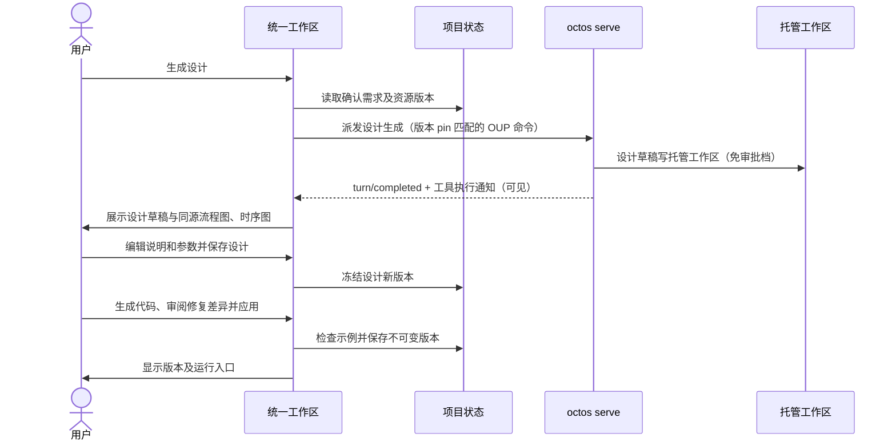

# Delta: core-S18-ai-development.md

## MODIFIED — 设计图与代码版本

未确认需求不能生成设计。设计参数改变使旧代码绑定过期；任意源码不可冒称执行。图节点绑定输入输出和源码行。

生产语义（embed-octos-runtime）：生成类任务经 octos 托管工作区产出文件并回流展示；agent 工具执行（读需求/写草稿）经 `tool/started`/`tool/completed` 通知对 GUI 可见，任务条呈现工具行；产物文件缺失或空白按失败处理，不得用 envelope 文本冒充。

本地原型动作不构成生产 API。正式接口须由后续运行时时序推导；本次无 API、DB、部署变更。对应检查见 core-S18-test-cases.md。
