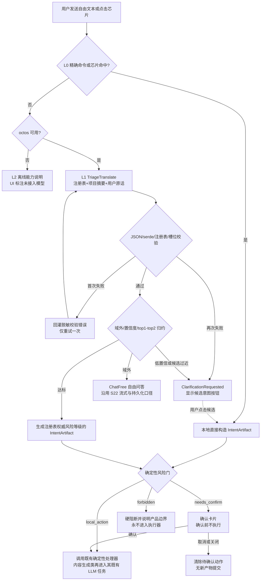

## MODIFIED — 自由对话在线化

- 对话输入先经 **L0 芯片/精确显式命令匹配**；命中后直接构造 Artifact 并进入确定性风险门，本地业务执行不经 LLM。未命中的非显式输入经 **L1 `TriageTranslate`** 识别；只有 Triage 明确判定域外时才进入既有自由问答，由真实 LLM 经 octos（OUP stdio）回复。任务条分别出现「意图转译 ·」和「对话回复 ·」进度行，两个 turn 串行复用 AgentWorker 单活跃口径。
- **需求草稿意图在线化（S23 / issue #39）**：自然语言研究想法经 L1 得到 `requirement.draft.requested` 后，由真实 LLM 以用户原话隐式生成结构化需求草稿（研究目标、范围、参数、验收标准）；L0「生成需求草稿 / 帮我生成需求」芯片仍走本地草稿行为。草稿填入需求页草稿框等用户编辑确认（不自动确认版本）。**草稿生成阶段**失败或 octos 不可用时降级为原文入草稿框并如实标注；Triage 阶段已经不可用时不得猜测 DraftRequirement 或擅自把任意原文入框，而走 S24 的 L2 能力说明。**草稿为结构化结果，一次性入框，不做逐字流式预览。**
- **流式口径（issue #41）**：自由对话及既有文本生成任务的 `message/delta` 增量帧继续实时预览并标记「生成中」；`turn/completed` 后以 `assistant_persisted` 持久化产物替换落定，RD-018 落盘口径不变。Triage 的结构化中间 JSON 只用于识别，不作为助手回复正文流式展示或持久化。octos 未发 delta 帧时诚实降级为一次性回显，工具调用结果仍等终态统一显示。
- **任务条进度细化（issue #41）**：流式期间对话任务条显示「对话回复 · 接收中 · Ns」及已收增量字数；多 Agent 任务条继续显示每路子任务状态。Triage 任务只显示「识别中 / 校验重试 / 已完成」等阶段，不把 JSON 字数冒称回复正文体量。
- 诚实降级：octos 不可用（profile 缺失 / 连接失败 / 版本不匹配）时，L0 继续可用，未识别的自由输入进入 L2 离线能力说明，右栏底部标注「离线预设交互 · 未接入模型」；接线可用时标注「AI 助手 · octos 已接线」。顶栏「演示环境」tag 保留（数据仍为合成样本，与模型接线无关）。

## ADDED — 意图即 Artifact 交互与系统处理流程（S24）

### 系统处理流程图

### 对话区与确认交互

- **Triage 过程**：右栏任务条只暴露「意图转译 / 校验重试 / 完成或失败」阶段；模型结构化回复不冒充助手自然语言答复。成功识别后展示将要执行的动作名称与风险状态，但不展示无必要的原始 JSON。
- **ClarificationRequested**：当第二次校验仍失败、top1 置信度低于阈值、top1/top2 差距不足或没有合法候选时，助手明确说明「未能可靠理解，请选择或补充说明」。候选按钮来自合法模型候选；无合法候选时使用固定高频动作候选。按钮点击等价于一次 L0 显式选择，直接构造 Artifact，不再调用模型猜测。
- **needs_confirm**：复用计划导出的模态确认卡片模式，泛化为动作标题、风险说明、确认/取消按钮和待确认 Artifact。确认只放行当前这一次动作；取消、关闭或项目切换均清除待确认状态，旧任务结果不得重新弹出或执行。
- **forbidden**：对话区给出明确阻断原因，不显示确认按钮、不提供重试执行入口。真实下单类意图没有确定性执行器，注册表加载与分发双重检查不得被模型自报 `risk_class` 覆盖。
- **日志与隐私**：对话消息和 S23 草稿仍按既有工作区边界保存；运行记录只写任务标签、类型 ID、状态与脱敏错误，不写用户原文、识别正文、槽位值、原始模型 JSON 或含这些内容的校验回灌文本。
