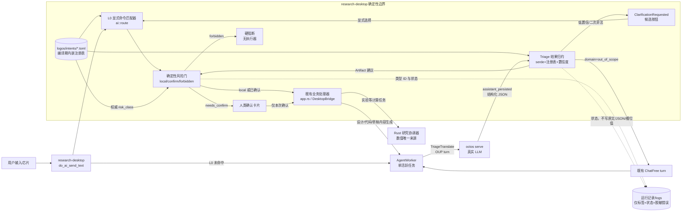

## ADDED — 9. 意图即 Artifact 转译架构（S24）

> 本节修订第 3 节「快捷提示沿用 S17 的 11 预设意图」的入口口径：现为 L0 显式命令 + L1 Triage + L2 降级，注册表包含 14 个业务种子类型；其余多 Agent 场景映射不变。本提案不建设 Artifact 黑板，不扩展 `consumes/publishes`，不把识别正文写入 `swarm_ledger`。

### 9.1 组件与信任边界架构图



**信任边界**：octos/LLM 位于建议侧，不能直接进入 `EXEC`。`GATE` 只接受通过注册表校验的内存 Artifact，并从注册表重新取得风险等级；模型回显的 `risk_class` 仅作格式检查与诊断，永远不能放宽风险。`ChatFree` 只产生对话回复，不具备业务执行语义。真实下单类没有 `EXEC` 映射。

### 9.2 注册表 schema 与种子类型

每个 `logos/intents/*.toml` 使用与 Agent manifest 相同的编译期 `include_str! + serde` 模式；运行时无需扫描目录，缺失/重复/非法声明在加载或测试中显式失败：

```toml
[type]
id = "experiment.run.requested"
description = "用户希望用当前已保存版本运行一次回测实验"
boundary_negative = ["看看上次实验结果", "先别跑实验"]
slots = { version = "optional<int>" }
risk_class = "needs_confirm"
examples = ["跑一下实验", "用 v2 回测", "帮我运行策略"]
```

- 六个字段均为必填；`boundary_negative`、`examples` 可为空数组但不得省略，`slots` 可为空表。槽位声明仅允许 `required|optional` 修饰 `string|int|number|bool`；Artifact 不得包含未声明槽位，必填槽位不得缺失，值类型必须匹配。
- `id` 全局唯一且采用稳定点分格式；`risk_class` 仅允许 `local_action | needs_confirm | forbidden`。可执行类型必须存在唯一 `Intent` 映射；`forbidden` 类型必须不存在执行映射，违反任一约束即拒绝注册表。
- 业务处理器必须检查槽位是否适用于当前状态；无法理解或不支持的语义槽位不得静默忽略后以默认值执行，应拒绝并说明或转为澄清。

| 现有 `Intent` / 禁止边界 | 注册类型 ID | 风险等级 | 非空槽位 |
|---|---|---|---|
| ConfirmRequirement | `requirement.confirm.requested` | local_action | — |
| DraftRequirement | `requirement.draft.requested` | local_action | — |
| NewProject | `project.create.requested` | local_action | `name: optional<string>` |
| SwitchProject | `project.switch.requested` | local_action | `project: optional<string>` |
| GenerateDesign | `design.generate.requested` | local_action | — |
| GenerateCode | `code.generate.requested` | local_action | — |
| SaveVersion | `version.save.requested` | local_action | — |
| RunExperiment | `experiment.run.requested` | **needs_confirm** | `version: optional<int>` |
| CompareExperiments | `experiment.compare.requested` | local_action | — |
| MakeReport | `report.generate.requested` | local_action | — |
| ExplainBoundary | `boundary.explain.requested` | local_action | — |
| PlanGenerate | `plan.generate.requested` | local_action | — |
| PlanCheck | `plan.check.requested` | local_action | — |
| PlanExport | `plan.export.requested` | **needs_confirm** | — |
| 真实下单禁止边界（非业务 Intent） | `order.live.submit.requested` | **forbidden** | `symbol: optional<string>`, `quantity: optional<int>` |

### 9.3 Triage JSON 契约与确定性归约

Triage prompt 由注册表描述/边界反例/示例、必要项目状态摘要和用户原话组成。模型只输出一个 JSON 对象，不输出 Markdown 或解释；候选最多 3 个：

```json
{
  "domain": "in_scope",
  "candidates": [
    {
      "type_id": "experiment.run.requested",
      "slots": {"version": 2},
      "confidence": 0.86,
      "risk_class": "needs_confirm"
    }
  ]
}
```

域外输出固定为 `{"domain":"out_of_scope","candidates":[]}`。`domain` 仅允许 `in_scope | out_of_scope`；`confidence` 必须位于 `[0,1]`；候选 `type_id` 必须已注册且不得重复，域外不得携带候选。允许模型回复被 JSON fence 或少量前后散文包围时提取最外层对象，但提取后的 serde/注册表校验不放宽。

归约规则全部是无 worker 的纯函数：

1. 按置信度降序排列候选；`domain=out_of_scope` 才返回 `ChatFree`，其余自由文本不得直接绕过 Triage 进入 ChatFree。
2. 首次 JSON/serde/注册表/槽位校验失败时，仅在内存中把**不包含用户原文和槽位值的校验摘要**及无效回复回灌模型，要求按同一 schema 修正；最多重试一次。第二次失败返回 `ClarificationRequested`，不是本地动作或 ChatFree。
3. `in_scope` 无合法候选、top1 置信度 `< 0.70` 或 top1-top2 差距 `< 0.15` 时澄清；0.70/0.15 为初始校准值，S24 用例集负责回归与校准，不将模型自报值解释为真实概率。无合法候选时使用固定高频 L0 候选按钮。
4. 达标候选归约为 `IntentArtifact{type_id, slots, confidence, risk_class}`；其中 `risk_class` 由注册表覆盖模型回显值。候选按钮点击直接构造 Artifact，不再调用 LLM。
5. 风险门输入包含 `confirmed: bool`：`local_action` 仅在未确认要求下直接分发；`needs_confirm` 只有当前待确认 Artifact 的人类确认才放行；`forbidden` 任意确认状态均阻断。每次确认绑定单一 Artifact，不能复用于后续动作。
6. 任务 ID 与项目 ID 是结果归属条件：过期、取消或跨项目结果只记录脱敏状态并丢弃，不得打开确认卡片、启动 ChatFree 或调用业务处理器。

### 9.4 失败、日志与持久化边界

- `turn/error`、profile/连接/版本失败属于通道失败，不当作 schema 重试；L0 保持可用，未完成识别的输入进入 L2，UI 明示未接入模型。已完成 DraftRequirement 识别后的生成失败仍走 S23 原文入框降级，两者不得混淆。
- `assistant_persisted` 仍是 Triage/ChatFree 的回复权威来源，`message/delta` 只用于允许预览的文本任务；Triage 中间 JSON 不作为聊天正文、版本产物或日志内容持久化。
- 运行记录与 logs 仅记录任务标签、注册类型 ID、尝试序号、状态及脱敏错误分类；禁止记录用户原话、原始模型 JSON、识别正文、槽位值和无效回复。OUP prompt 只在 worker 内存与既有 octos 请求边界内传递。
- 本提案不新增 Artifact 事件总线、持久化黑板、多意图 fan-out 或语义订阅；`swarm_ledger` 仍只承担既有多 Agent 派发账本职责。
