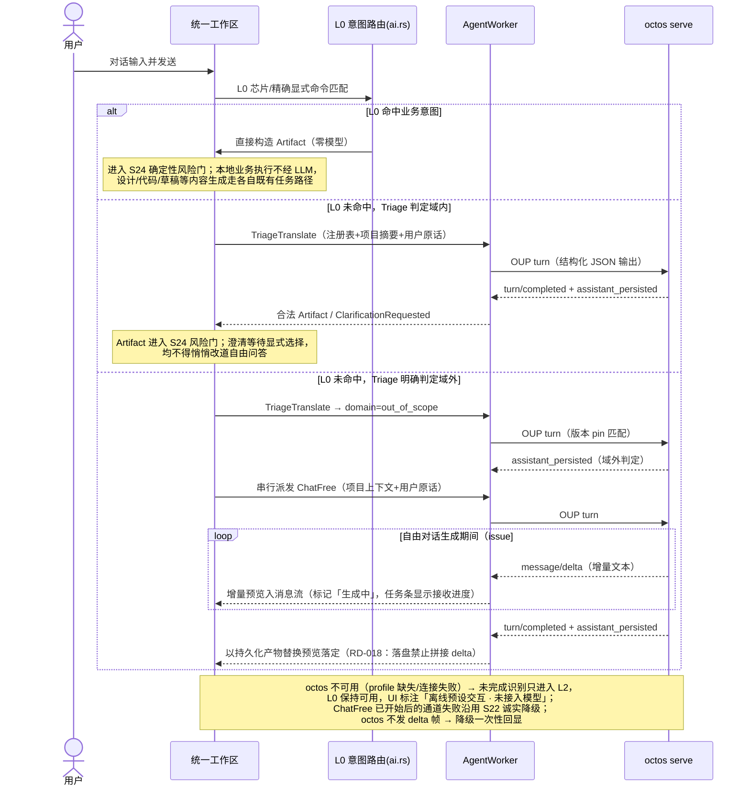

## MODIFIED — 自由对话派发（在线）

自由问答的唯一自然语言入口是 **Triage 的 `domain=out_of_scope` 归约结果**；`Unknown` 不再直接等价于 ChatFree。Triage 中间 JSON 不使用 S22 的聊天流式预览，也不进入消息持久化；ChatFree 的流式、任务条与 `assistant_persisted` 权威口径不变。完整识别/重试/澄清与风险门时序见 `core-S24-intent-as-artifact.md`。
