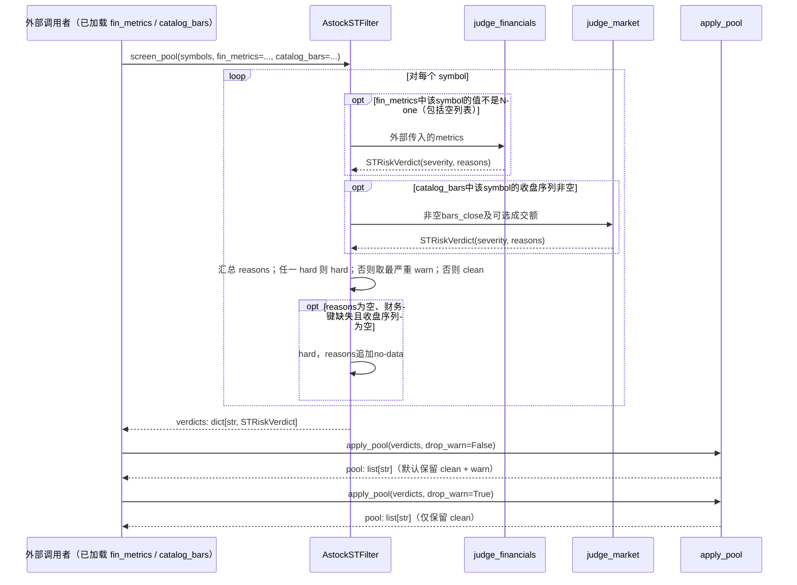

## ADDED — ST 风险筛选器内部契约（独立 Python 辅助模块）

### 范围声明

`AstockSTFilter` 是 A股数据接入的**独立 Python 辅助筛选器**，不接入 S12 Rust 规则引擎的三态时点评估，也不读取 Rust 快照 auxiliary。其输出 `hard`/`warn`/`clean` 为**研究风险评分**，必须通过 `reasons` 区分是财务/行情命中还是数据不足的保守排除；该输出**不得替代**交易所正式 *ST/ST 公告。

### 内部 API 契约

| 方法 | 输入 | 输出 | 职责 |
|---|---|---|---|
| `judge_financials(symbol, metrics)` | `metrics: list[FinancialMetrics]`，按报告期升序 | `STRiskVerdict` | 财务判据：净资产为负、最近 N 期均净亏损、单期亏损、亏损且营收低于 1 亿元 |
| `judge_market(symbol, bars_close, bars_turnover)` | 收盘价序列、可选成交额序列 | `STRiskVerdict` | 行情判据：长期均价低于 2 元、日均成交额低于 500 万元 |
| `screen_pool(symbols, catalog_bars, catalog_turnovers, fin_metrics)` | 股票池 + 外部传入的行情/财务字典 | `dict[str, STRiskVerdict]` | 汇总每个标的的财务与行情判定，任一 hard 即 hard |
| `apply_pool(verdicts, drop_warn)` | `screen_pool` 输出 | `list[str]` | 默认保留 clean/warn；`drop_warn=True` 时仅保留 clean |

### 调用时序（Mermaid）

### 数据不足与字段缺失的处理口径

- **直接调用的空输入**：judge_financials([]) 返回 hard+no-financial-data，judge_market([]) 返回 hard+no-market-data，属于数据不足的保守排除。
- **股票池汇总的缺失源**：screen_pool 对缺失财务键跳过财务判据，对空收盘序列跳过行情判据；仅两源均不可用且无已有原因时追加 no-data 并 hard。只有一类数据时仍可能 clean，不保证已检查另一类风险。
- **部分字段缺失**：
  - revenue缺失但已知单期亏损且未命中其他hard条件时返回warn，原因仅为“最近一期亏损”；没有revenue-missing提示。
  - bps/net_profit等关键字段缺失时可能返回clean且reasons为空。当前接口不披露这些缺失字段，此项为明确局限，不能据此认定财务健康。
- 当前实现没有unknown枚举，也没有公告可见时间与修订冻结能力。本次只收编实际行为并披露限制，不新增缺失提示或年度判定功能。

### 与 S12 Rust 规则引擎的关系

- S12 规则引擎通过快照 `financial` auxiliary 实现三态时点评估（命中/不满足/未知），支持 `available_at ≤ as_of` 与修订号取最大。
- `AstockSTFilter` 是 Python 侧的**当前时点预筛查**，不读取 S12 快照，也不产生 `unknown` 判定。
- 两者可共存：研究员可先用 `AstockSTFilter` 做快速预筛，再用 S12 规则引擎做严格时点研究；但**禁止**把 `AstockSTFilter` 的结果直接当作严格历史研究的输入。
