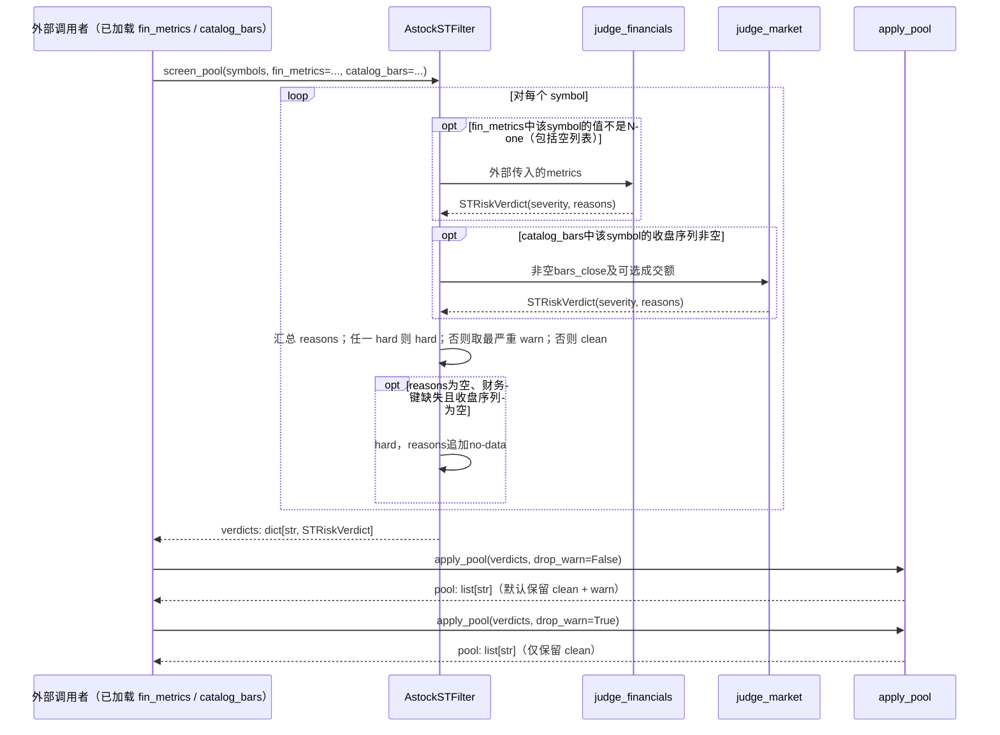

# 全流程与版本

## 全流程与版本

统一工作区以研究项目和对话为入口，首次打开显示项目概览与需求草稿，并提供数据中心引导。需求、设计、策略代码、实验与计划使用同一项目上下文。所有“保存”生成新版本；引用旧版本的实验不变。用户更改已确认配置使关联产物标为过期，必须重新计算才可导出计划。运行按钮预检数据、参数和成本；失败定位到字段与修复入口。

## 筛选语义

规则是 AND 条件组，组内可选 OR；首版最多20条件、深度2。条件支持板块集合、交易日上市年龄、原始收盘价、过去N日真实成交额均值、可见财务字段。数值比较支持 >=、<=、区间，单位显式展示。成交额缺失不以收盘价×成交量伪装真实值。
价格／流动性窗口只含 as_of 及此前完整交易日；停牌日成交额计0，日线缺失且状态未知则条件未知。财务取 available_at≤as_of 的最新可见版本；缺失原因与数值不满足区分。排序按指标降序，平局按 instrument_id 升序。预览同时给出三态计数；保存记录规则、快照、as_of、成员及排除原因。
固定池只用于形成时点以后；动态池每个调仓日重放规则。存活者样本只可探索研究，报告与导出均携带限制。

## 策略与成交语义

EMA 模板：adjust=false 的递推 EMA，首个收盘价为种子，alpha=2/(n+1)，预热至少慢线 n 根；快线>慢线分配等权，<= 时归零。只在选定调仓日提交目标；不足预热标的排除并显示原因。
动量模板：score=P(t-s)/P(t-s-L)-1，L为窗口、s为跳过交易日数，至少 L+s+1 根。按分数选前K名且 score>0；平局按代码。等权预算对K个槽位分配，少于K时其余留现金。EMA 同样采用K槽位，对合格标的按代码选前K，避免隐式改变权重。
日调仓为每个交易日，周／月调仓为交易日历的当周／月最后交易日。t日收盘形成目标，最早t+1交易日开盘模拟成交；绝不在计算t收盘信号的同一根bar收盘成交。以t日净值与参考收盘价估算整数数量，t+1先卖后买；资金不足按代码顺序向下缩减可买单位。未成交部分当日失效，下一调仓重新生成；不无限挂单。
模拟执行价=次日原始开盘价×(1±滑点基点/10000)，按价格步长买上取整、卖下取整。若超出合法价格边界则不成交。停牌、缺价、成交量为0不成交；触及对应方向涨跌停的开盘保守拒绝该方向成交，不声称可还原队列。单标的成交量不超过预先配置的前20日平均成交量比例，默认1%；不足20日严格模式拒绝。此为日线流动性近似，报告始终披露。
买入数量遵循规则包最小申报量／步长，卖出遵循可卖库存与零股规则；买入当日不可卖按规则包执行。佣金双边、最低佣金、卖出税费及其他费用按生效日期配置，以每笔实际成交额计算，不统一硬编码。公司行为按事件处理股数、现金和应收分红，除权日前信号只能用此前可见调整信息；复权价不得直接进入资金结算。
最后交易日按原始收盘价估值，不默认强制平仓；缺估值价格使用最近价格并标注陈旧，超过用户上限（默认5交易日）严格结果失败。退市处理需终止现金流／回收假设，缺失时严格回测失败。

## 实验与比较

保存模板版本、参数、时间范围、预热、规则包、费用、快照、资金、随机种子和软件版本。网格参数明确枚举且≤100组合，默认按样本内年化收益／最大回撤指标排序；回撤为0时不使用该比值。样本外区间严格晚于训练区间，参数在边界冻结；预热可使用之前价格但不能计入样本外收益。每次打开样本外结果记录查看事件，不将反复查看包装为独立验证。
总收益=末净值/初始净值-1；年化=(末/初)^(365.25/自然日跨度)-1，跨度为0或净值非正时为空；日收益从相邻交易日净值计算，首日以初始资金为前值；波动率=日收益样本标准差×sqrt(252)；Sharpe=日超额收益均值/样本标准差×sqrt(252)，无风险年率默认0并存档；最大回撤=max(1-净值/历史峰值)，峰值含初始资金。
交易日数不足2或方差为0的风险指标为空并显示原因。换手=区间成交额总和/每日平均净资产，明确为双边口径；费用单独汇总。无成交时收益来自现金／公司行为，不伪造胜率。
基准需独立数据快照和价格／全收益口径；与策略相同日期归一为1，缺失不插值伪造超额收益。比较保留各自完整区间，另提供明确标识的交集视图；不静默截断。不同区间、资金、费用或数据版本显示不可直接排名说明。

## 人工计划

选择已保存策略配置、最新完整数据快照和手工持仓版本，复用策略信号计算，不从历史末尾持仓直接复制。输入总资产、现金、每股数量与可卖数量；校验非负且可卖≤持仓。计算下一交易日目标与参考调整量，显示买卖原因、预计成本、现金余量和持仓差额；手工持仓与数据时点不同需显式确认，写入限制。
计划不可变；修改持仓或参数生成新计划。CSV 导出 UTF-8 BOM，含生成时间、as_of、计划ID、策略与快照ID、代码、名称、目标权重、当前／可卖／目标／调整股数、参考价、限制。对以=、+、-、@开头的自由文本做表格公式转义。覆盖已有文件需文件对话框明确确认；失败保留旧文件。手工执行备注另存，不更新模拟回测成交。

## 统一离线原型的演示范围

以下为单文件原型的有限演示，不替代上文生产产品的筛选、成交、费用、公司行为、指标与导出规则。

### 全流程与版本
需求草稿 → 确认需求 → 设计说明与处理图 → 保存代码版本 → 调试与回测实验 → 策略验证 → 计划草稿 → 账户约束核对 → 导出演示清单。
每个项目有独立对话、草稿、版本、实验、报告及计划。资源位于统一工作区，切换不重建项目。所有异步任务绑定启动时项目与输入，取消或失败不提交成果。

### 筛选语义
数据中心提供合成样本快照及模拟更新；股票池可搜索、按成交额筛选、查看入选原因并保存规则与成员。资源保存后创建新快照或规则版本，旧实验继续引用原输入，当前实验与验证结论标记过期。
历史实际研究仍须使用当时可见数据、历史股票池成员、公告时点与复权口径；原型不声称覆盖这些生产能力。

### 策略与成交语义
设计结构记录数据、过滤、信号、仓位、成交、指标六节点。信号在 2026-01-05 收盘形成，执行在 01-06 开盘发生；修复逻辑仅在执行时使用开盘价与费用约束，不将未来价格泄漏到信号。
预置 v1 用信号收盘价计算股数，v2 在成交阶段按可用资金重新约束股数。演示采用 100 股单位、每笔 5 元费用，均为样本假设。

### 实验与比较
单次实验冻结需求、设计、代码、参数、数据快照、股票池及模拟器。默认资金 10000，A 收盘信号价 10，开盘 10.1，随后收盘 10.4/10.8。v1 的 1000 股订单需要 10105，拒绝后净值 10000；v2 买入 900 股，现金 905，期末 10625，收益 6.25%。
曲线和指标来自账户计算；无成交、不满足筛选时持现金。实验比较可定位事件分歧；切换代码版本不修改历史实验。

### 验证边界
调试解释实现行为；回测给出历史模拟表现；策略验证按需求标准综合证据。当前版本的演示检查须具有实际运行、无资金拒绝和有效上游引用。真实数据、样本外与稳健性均标记未运行，正式策略结论为证据不足，不能由人工勾选改成通过。

### 人工计划
演示计划绑定通过演示检查的当前冻结版本，使用独立计划数据快照、账户现金、持仓及可卖数量。目标资金以现金加持仓市值计算，预留买入费用，不将可用现金误当成全部资产。假设卖出收入不参与本轮买入可用现金。
草稿计算目标与差额；核对可卖数量、现金、交易单位、快照时效和版本状态后才能导出。修改输入立即使核对失效；导出同时复核。演示计划无自动下单且不声称预测收益。

## ST 风险筛选器内部契约（独立 Python 辅助模块）

### 范围声明

`AstockSTFilter` 是 A股数据接入的**独立 Python 辅助筛选器**，不接入 S12 Rust 规则引擎的三态时点评估，也不读取 Rust 快照 auxiliary。其输出 `hard`/`warn`/`clean` 为**研究风险评分**，必须通过 `reasons` 区分是财务/行情命中还是数据不足的保守排除；该输出**不得替代**交易所正式 *ST/ST 公告。

### 内部 API 契约

| 方法 | 输入 | 输出 | 职责 |
|---|---|---|---|
| `judge_financials(symbol, metrics)` | `metrics: list[FinancialMetrics]`，按报告期升序 | `STRiskVerdict` | 财务判据：净资产为负、最近 N 期均净亏损、单期亏损、亏损且营收低于 1 亿元 |
| `judge_market(symbol, bars_close, bars_turnover)` | 收盘价序列、可选成交额序列 | `STRiskVerdict` | 行情判据：长期均价低于 2 元、日均成交额低于 500 万元 |
| `screen_pool(symbols, catalog_bars, catalog_turnovers, fin_metrics)` | 股票池 + 外部传入的行情/财务字典 | `dict[str, STRiskVerdict]` | 汇总每个标的的财务与行情判定，任一 hard 即 hard |
| `apply_pool(verdicts, drop_warn)` | `screen_pool` 输出 | `list[str]` | 默认保留 clean/warn；`drop_warn=True` 时仅保留 clean |

### 调用时序（Mermaid）

### 数据不足与字段缺失的处理口径

- **直接调用的空输入**：judge_financials([]) 返回 hard+no-financial-data，judge_market([]) 返回 hard+no-market-data，属于数据不足的保守排除。
- **股票池汇总的缺失源**：screen_pool 对缺失财务键跳过财务判据，对空收盘序列跳过行情判据；仅两源均不可用且无已有原因时追加 no-data 并 hard。只有一类数据时仍可能 clean，不保证已检查另一类风险。
- **部分字段缺失**：
  - revenue缺失但已知单期亏损且未命中其他hard条件时返回warn，原因仅为“最近一期亏损”；没有revenue-missing提示。
  - bps/net_profit等关键字段缺失时可能返回clean且reasons为空。当前接口不披露这些缺失字段，此项为明确局限，不能据此认定财务健康。
- 当前实现没有unknown枚举，也没有公告可见时间与修订冻结能力。本次只收编实际行为并披露限制，不新增缺失提示或年度判定功能。

### 与 S12 Rust 规则引擎的关系

- S12 规则引擎通过快照 `financial` auxiliary 实现三态时点评估（命中/不满足/未知），支持 `available_at ≤ as_of` 与修订号取最大。
- `AstockSTFilter` 是 Python 侧的**当前时点预筛查**，不读取 S12 快照，也不产生 `unknown` 判定。
- 两者可共存：研究员可先用 `AstockSTFilter` 做快速预筛，再用 S12 规则引擎做严格时点研究；但**禁止**把 `AstockSTFilter` 的结果直接当作严格历史研究的输入。
