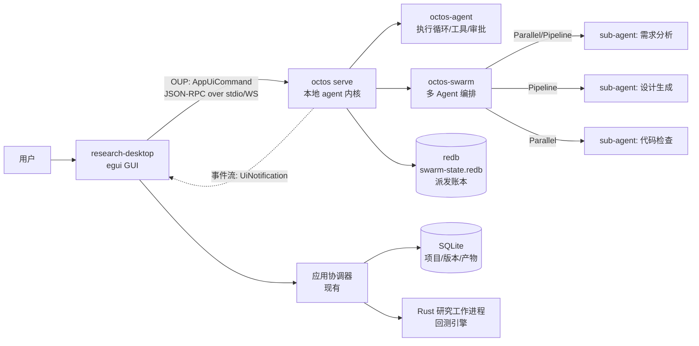
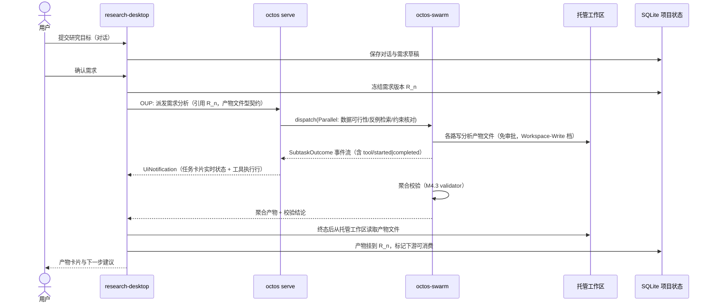
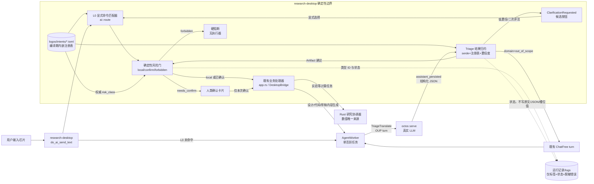

# 多 Agent 协作生产架构（core-06）

> 状态：设计草案 · 归属模块：core · 关联场景：S17（需求与多Agent协作）、S18（流程与开发）、S19（调试与实验）
> 本文回答一个问题：OpenLogos 原型（core-05）中的"后台多 Agent 协作"如何落地为生产实现。
> 结论：**不重新发明运行时**——以本地 octos 内核（octos-agent / octos-swarm）为底座，research-desktop 通过 OUP（Octos UI Protocol）接入。

## 1. 设计决策总览

| 决策点 | 选择 | 理由 |
|---|---|---|
| Agent 运行时 | **复用 octos 内核**（`octos serve` 进程） | octos 已提供 agent 执行循环、工具、审批、任务监督、持久化账本；原型中的"演示计算器"在生产中就是真实的 sub-agent dispatch |
| 多 Agent 编排 | **客户端侧并行 turn（SwarmBridge 经 OUP stdio）**（ADR 修订，swarm-ledger-adr） | octos-swarm 不作为库公开发布（仅以 CLI 分发），stdio 客户端无法进程内复用；SwarmBridge 已具备 Parallel/Pipeline 拓扑、幂等键、真实 turn 终态归约、turn/interrupt 中断、redb 账本恢复、聚合校验 |
| 接入方式 | **OUP over stdio（`octos-core` 类型化协议 + 能力协商）**（参考 octoscode；embed-octos-runtime 修订） | octoscode 的接线方式：客户端不内嵌 agent，而是通过 `AppUiCommand`/JSON-RPC 与 `octos serve` 通信；本修订以自包含类型化常量对齐协议（`REQUIRED_OCTOS_RELEASE` 版本 pin 保证协议匹配；`octos-core` crate 引入列为后续可选——git 依赖与离线 verify/deny 治理的权衡另行提案），客户端解析 `tool/started`/`tool/completed` 通知使 agent 工具执行对 GUI 可见；能力协商头与 WebSocket 通道均保留为后续可选（stdio 通知路径为当前唯一已验证路径） |
| Server 保障 | **backend_ensure 三级解析 + `REQUIRED_OCTOS_RELEASE` 版本 pin**（embed-octos-runtime 新增） | 参考 octoscode `backend_ensure`：octos 二进制按「内嵌资源 → `~/.octos/bin` → PATH」顺序解析，缺失/版本不匹配给出中文诊断与安装指引；桌面 spawn 不再裸依赖用户 PATH（本机实测 GUI 进程 PATH 缺 cargo bin 即断线）；版本 pin 保证客户端协议类型与 server 一致 |
| Agent 定义 | **AgentDefinition 清单**（JSON/TOML manifest） | 声明式能力包络：工具白/黑名单、模型偏好、生命周期钩子；与 Claude Code 的 AgentDefinition 字段对齐 |
| 状态持久化 | **redb 派发账本 + SQLite 项目元数据** | swarm 派发状态用 research-desktop 自建 redb 账本（`swarm_ledger`，幂等恢复；ADR 修订：原为 octos 自带 ledger）；研究项目/版本/产物用 research-desktop 现有 SQLite |
| 闭环权限 | **默认 Workspace-Write 免审批 + 托管工作区产物回流**（embed-octos-runtime 新增） | 2026-10-11 闭环探针实证：默认 Local 会话（Workspace-Write 档）下 agent 工具调用零审批阻塞、产物落盘于 octos 托管工作区；Full-Access 档（`--danger-full-access`）为人类显式决策项，永不默认（对齐 octoscode「免沙箱亲手做、不让 agent 代按」纪律） |
| 前端呈现 | **隐藏编排细节**（延续 core-05 决策） | 用户不选角色、不配预算；只呈现任务状态卡片与产物引用 |
## 2. 运行时拓扑



**职责边界**（对齐 octoscode 的 client/server 划分）：

- **research-desktop（客户端）**：渲染、键盘/鼠标、本地视图状态、把用户意图翻译为 OUP 命令、展示任务卡片与产物引用
- **octos serve（服务端）**：session 管理、agent 执行、工具调用与沙箱、审批、swarm 派发与聚合、持久化账本
- **Rust 研究工作进程（不变）**：回测/筛选等计算任务——Agent 的"运行实验"动作最终以类型化消息发给现有协调器，**数值结果必须来自计算任务，不由 LLM 生成**（延续 core-05 的硬约束）

## 3. 场景映射：原型 → 生产

| 原型行为（core-05） | 生产实现 |
|---|---|
| 快捷提示"生成需求/设计/代码/实验/验证" | 对话意图路由（沿用 S17 的 11 预设意图）→ 映射为对应 `ContractSpec` 派发 |
| "正在分析需求/生成设计/运行检查"任务卡片 | swarm `SubtaskOutcome` 状态（queued/running/succeeded/failed/cancelled）经 OUP `UiNotification` 推送到 GUI |
| 取消 / 重试任务 | OUP 命令 → swarm dispatch 的取消语义；重试创建新 dispatch 并关联 `retry_of`（与协调器任务协议一致） |
| 预算字段（原型 #budget） | `SwarmBudget.max_contracts` + `max_retry_rounds`（上限 3 轮）；token 预算由 octos-agent 的 `budget.rs` 承载，**不向用户暴露** |
| "Agent 为预设产物"（演示数据） | 生产 Agent 产出 = 真实 sub-agent 产物 + 校验器结论；未经校验/未运行的产物不得标"通过" |
| 版本冻结/过期语义 | 不变，仍由 research-desktop SQLite 承担；Agent 产出写入前必须引用已冻结的需求/设计版本 ID |

### S17 需求与多 Agent 协作（生产时序）



**与原型的关键差异**：原型里 `startAgents` 是 setTimeout 模拟；生产中每个 subtask 是真实 dispatch，redb 账本保证崩溃后可恢复，聚合校验失败会阻断产物标记为可用。**（embed-octos-runtime）** 三路契约 prompt 升级为产物文件型：每路在托管工作区写分析文件，终态后桌面从工作区回流产物文本挂载 R_n（aggregate_valid 口径不变：全部 Succeeded 且 output 非空白才允许挂载）。
## 4. Agent 定义清单（manifest）

> **ADR 修订（agent-definitions，issue #22，2026-10-10）**：experiment-runner
> 不再设计为「持协调器工具的 agent」——实验执行由桌面侧直接调协调器
> （`DesktopBridge::submit_run`），LLM 只整理参数表单（`parse_run_params`
> 严格校验，拒绝任何结果数值字段），不持协调器工具、不产出数值、不触发
> 运行。octos stdio 侧无 agent/工具注册 API（见 #16/#20 能力子集说明），
> 工具白名单的约束力落在客户端派发校验（manifest definition_id）上。
> manifest 为权威声明源，经 include_str! 编译期内嵌进 research-desktop。

在 `logos/agents/` 下放置声明式清单（schema 对齐 octos `AgentDefinition`，version=1）：

```toml
# logos/agents/requirement-analyst.toml
name = "requirement-analyst"
version = 1
tools = ["read_file", "grep", "glob", "web_search"]
disallowed_tools = ["shell", "write_file", "edit_file"]
model = "anthropic/claude-sonnet"
```

```toml
# logos/agents/design-generator.toml
name = "design-generator"
version = 1
tools = ["read_file", "write_file", "grep", "glob"]
disallowed_tools = ["shell"]
```

```toml
# logos/agents/code-reviewer.toml
name = "code-reviewer"
version = 1
tools = ["read_file", "grep", "glob", "shell"]  # shell 仅用于 cargo check / 预置检查脚本
```

| Agent | 职责 | 拓扑位置 |
|---|---|---|
| requirement-analyst | 需求可行性分析、反例检索、约束核对 | S17 Parallel 分支 |
| design-generator | 由确认需求生成设计草稿与流程图节点结构 | S18 Pipeline 头 |
| code-reviewer | 策略代码静态检查、预置示例比对 | S18 Pipeline 尾 |
| experiment-runner（薄封装） | **只整理实验参数表单**（ADR 修订，agent-definitions）：实验执行由桌面侧直接调协调器（`DesktopBridge::submit_run`），LLM 不持协调器工具、不产出数值、不触发运行 | S19 参数整理 |

加载规则沿用 octos：目录扫描 + 内置默认 + 同名覆盖；`SpawnTool` 的 `agent_definition_id` 引用清单，内联字段优先。

## 5. 关键生产约束（继承自原型设计）

1. **数值结果必须来自计算任务**：实验执行由桌面侧直接调协调器（ADR 修订，agent-definitions：原为 experiment-runner 发消息给协调器）；LLM 不得生成回测数值、不得触发运行（core-05 硬约束，不变）
2. **未确认需求不能生成设计**：dispatch 前校验上游冻结引用（`contracts_fingerprint` 类似物：需求版本哈希）
3. **任意源码不可冒称执行**：code-reviewer 只接受预置示例完整匹配才允许进入演示运行（S18 语义保留）
4. **正式验证恒需真实证据**：真实数据/样本外/稳健性缺失时报告必须显示"证据不足"（S19 语义保留）
5. **幂等与恢复**：所有 dispatch 携带 idempotency 键（dispatch_id + 契约指纹）；GUI 重启后从自建 redb 账本（`swarm_ledger`）重建任务卡片状态——未完成派发一律标记「中断（进程重启）」（诚实口径：octos 子进程已随旧进程死亡，不得假装仍在运行）
6. **项目隔离**：dispatch 的 `session_id` 绑定 research-desktop 项目 ID；切换项目不影响在途任务归属
7. **零新增 unsafe**：遵循 octos workspace `deny(unsafe_code)`
8. **权限档显式化（embed-octos-runtime）**：会话默认 Workspace-Write 档（工作区内免审批，实证于 2026-10-11 闭环探针）；Full-Access/免沙箱档只能由人类在 GUI 显式选择并二次确认，产品永不代选、不在任何自动化路径（含测试默认值）中启用；agent 产物只从托管工作区回流，不直接写用户任意路径
## 6. 落地批次建议

| 批次 | 内容 | 验收 |
|---|---|---|
| M1 | research-desktop 内嵌 OUP 客户端（stdio  spawn `octos serve`），单 Agent 对话通路 | 对话→需求草稿→SQLite 落库 |
| M2 | swarm Parallel 接入 S17（三并发分析 sub-agent），任务卡片实时状态 | ST-S17-16 全旅程（真实协调器） |
| M3 | Pipeline 接入 S18（设计→代码检查），版本冻结引用校验 | ST-S18 系列 |
| M4 | S19 实验派发与验证证据链；redb 崩溃恢复演练 | ST-S19 系列 + 中断恢复 |

每批次仍需走 OpenLogos 变更提案流程（change-writer → delta → verify），本文件为架构 delta 的输入，不直接授权实现。

## 7. Server 保障与内嵌运行时（backend ensure）

参考 octoscode `backend_ensure.rs` 的客户端成熟实践，research-desktop 在 spawn 前完成 octos 二进制的**解析与校验**：

- **三级解析顺序**：① 分发物内嵌资源（随包 octos bundle，对齐 core-03「运行时随包、不依赖用户 PATH」的 Python 桥接先例）→ ② `~/.octos/bin/octos`（octoscode 兼容安装位）→ ③ `PATH`。命中即用，逐级降级并在启动日志记录实际来源。
- **版本 pin**：客户端编译期常量 `REQUIRED_OCTOS_RELEASE` 与内嵌 bundle 严格一致；非内嵌来源命中时执行 `octos --version` 校验，不匹配给出中文诊断（提示协议不兼容风险与安装指引），**不静默继续**。
- **失败显式化**：三级全缺失时 GUI 给出引导卡片（含安装命令与文档链接），任务派发入口禁用；不出现「点了没反应」的静默失败。
- **不自动下载**：与 octoscode 首启自动下载不同，research-desktop 分发物内嵌为主；缺失时引导人工安装（离线交付口径，见 core-03）。

## 8. 闭环权限与托管工作区

**托管工作区路径契约**：octos stdio 会话的工作区不是子进程 cwd，而是托管工作区
`<instance-data-dir>/profiles/<profile_id>/data/users/<session_user>/workspace/`。
桌面端产物回流一律从该路径读取（2026-10-11 闭环探针实证：工具写文件落盘于此）。

**权限档语义**（对齐 `octos serve --help` 与 octoscode M12 契约）：

| 档位 | 语义 | 桌面端处理 |
|---|---|---|
| Workspace-Write（默认） | 工作区内读写免审批、文件系统仍沙箱、网络默认放行（`--no-network` 可关） | 默认档；S17/S18 产物文件型任务在此档闭环 |
| Full-Access（`--danger-full-access`，需 `--solo`） | 沙箱禁用、审批永不提示 | **人类显式决策项**：GUI 二次确认后才可用，永不默认、不让 agent 代选 |
| 审批档（默认之外显式开启） | 越界操作发 `ApprovalRequested` | 本提案不实现审批 UI（octos stdio 默认档不触发）；列为后续可选 |

**产物回流规则**：终态（turn/completed）后桌面从托管工作区读取契约声明的产物文件；文件缺失或空白视为该路失败（诚实口径，不得用 envelope 文本冒充文件产物）；挂载仍过 `aggregate_valid` 聚合校验。

## 9. 意图即 Artifact 转译架构（S24）

> 本节修订第 3 节「快捷提示沿用 S17 的 11 预设意图」的入口口径：现为 L0 显式命令 + L1 Triage + L2 降级，注册表包含 14 个业务种子类型；其余多 Agent 场景映射不变。本提案不建设 Artifact 黑板，不扩展 `consumes/publishes`，不把识别正文写入 `swarm_ledger`。

### 9.1 组件与信任边界架构图



**信任边界**：octos/LLM 位于建议侧，不能直接进入 `EXEC`。`GATE` 只接受通过注册表校验的内存 Artifact，并从注册表重新取得风险等级；模型回显的 `risk_class` 仅作格式检查与诊断，永远不能放宽风险。`ChatFree` 只产生对话回复，不具备业务执行语义。真实下单类没有 `EXEC` 映射。

### 9.2 注册表 schema 与种子类型

每个 `logos/intents/*.toml` 使用与 Agent manifest 相同的编译期 `include_str! + serde` 模式；运行时无需扫描目录，缺失/重复/非法声明在加载或测试中显式失败：

```toml
# logos/intents/experiment.run.requested.toml
[type]
id = "experiment.run.requested"
description = "用户希望用当前已保存版本运行一次回测实验"
boundary_negative = ["看看上次实验结果", "先别跑实验"]
slots = { version = "optional<int>" }
risk_class = "needs_confirm"
examples = ["跑一下实验", "用 v2 回测", "帮我运行策略"]
```

- 六个字段均为必填；`boundary_negative`、`examples` 可为空数组但不得省略，`slots` 可为空表。槽位声明仅允许 `required|optional` 修饰 `string|int|number|bool`；Artifact 不得包含未声明槽位，必填槽位不得缺失，值类型必须匹配。
- `id` 全局唯一且采用稳定点分格式；`risk_class` 仅允许 `local_action | needs_confirm | forbidden`。可执行类型必须存在唯一 `Intent` 映射；`forbidden` 类型必须不存在执行映射，违反任一约束即拒绝注册表。
- 业务处理器必须检查槽位是否适用于当前状态；无法理解或不支持的语义槽位不得静默忽略后以默认值执行，应拒绝并说明或转为澄清。

| 现有 `Intent` / 禁止边界 | 注册类型 ID | 风险等级 | 非空槽位 |
|---|---|---|---|
| ConfirmRequirement | `requirement.confirm.requested` | local_action | — |
| DraftRequirement | `requirement.draft.requested` | local_action | — |
| NewProject | `project.create.requested` | local_action | `name: optional<string>` |
| SwitchProject | `project.switch.requested` | local_action | `project: optional<string>` |
| GenerateDesign | `design.generate.requested` | local_action | — |
| GenerateCode | `code.generate.requested` | local_action | — |
| SaveVersion | `version.save.requested` | local_action | — |
| RunExperiment | `experiment.run.requested` | **needs_confirm** | `version: optional<int>` |
| CompareExperiments | `experiment.compare.requested` | local_action | — |
| MakeReport | `report.generate.requested` | local_action | — |
| ExplainBoundary | `boundary.explain.requested` | local_action | — |
| PlanGenerate | `plan.generate.requested` | local_action | — |
| PlanCheck | `plan.check.requested` | local_action | — |
| PlanExport | `plan.export.requested` | **needs_confirm** | — |
| 真实下单禁止边界（非业务 Intent） | `order.live.submit.requested` | **forbidden** | `symbol: optional<string>`, `quantity: optional<int>` |

### 9.3 Triage JSON 契约与确定性归约

Triage prompt 由注册表描述/边界反例/示例、必要项目状态摘要和用户原话组成。模型只输出一个 JSON 对象，不输出 Markdown 或解释；候选最多 3 个：

```json
{
  "domain": "in_scope",
  "candidates": [
    {
      "type_id": "experiment.run.requested",
      "slots": {"version": 2},
      "confidence": 0.86,
      "risk_class": "needs_confirm"
    }
  ]
}
```

域外输出固定为 `{"domain":"out_of_scope","candidates":[]}`。`domain` 仅允许 `in_scope | out_of_scope`；`confidence` 必须位于 `[0,1]`；候选 `type_id` 必须已注册且不得重复，域外不得携带候选。允许模型回复被 JSON fence 或少量前后散文包围时提取最外层对象，但提取后的 serde/注册表校验不放宽。

归约规则全部是无 worker 的纯函数：

1. 按置信度降序排列候选；`domain=out_of_scope` 才返回 `ChatFree`，其余自由文本不得直接绕过 Triage 进入 ChatFree。
2. 首次 JSON/serde/注册表/槽位校验失败时，仅在内存中把**不包含用户原文和槽位值的校验摘要**及无效回复回灌模型，要求按同一 schema 修正；最多重试一次。第二次失败返回 `ClarificationRequested`，不是本地动作或 ChatFree。
3. `in_scope` 无合法候选、top1 置信度 `< 0.70` 或 top1-top2 差距 `< 0.15` 时澄清；0.70/0.15 为初始校准值，S24 用例集负责回归与校准，不将模型自报值解释为真实概率。无合法候选时使用固定高频 L0 候选按钮。
4. 达标候选归约为 `IntentArtifact{type_id, slots, confidence, risk_class}`；其中 `risk_class` 由注册表覆盖模型回显值。候选按钮点击直接构造 Artifact，不再调用 LLM。
5. 风险门输入包含 `confirmed: bool`：`local_action` 仅在未确认要求下直接分发；`needs_confirm` 只有当前待确认 Artifact 的人类确认才放行；`forbidden` 任意确认状态均阻断。每次确认绑定单一 Artifact，不能复用于后续动作。
6. 任务 ID 与项目 ID 是结果归属条件：过期、取消或跨项目结果只记录脱敏状态并丢弃，不得打开确认卡片、启动 ChatFree 或调用业务处理器。

### 9.4 失败、日志与持久化边界

- `turn/error`、profile/连接/版本失败属于通道失败，不当作 schema 重试；L0 保持可用，未完成识别的输入进入 L2，UI 明示未接入模型。已完成 DraftRequirement 识别后的生成失败仍走 S23 原文入框降级，两者不得混淆。
- `assistant_persisted` 仍是 Triage/ChatFree 的回复权威来源，`message/delta` 只用于允许预览的文本任务；Triage 中间 JSON 不作为聊天正文、版本产物或日志内容持久化。
- 运行记录与 logs 仅记录任务标签、注册类型 ID、尝试序号、状态及脱敏错误分类；禁止记录用户原话、原始模型 JSON、识别正文、槽位值和无效回复。OUP prompt 只在 worker 内存与既有 octos 请求边界内传递。
- 本提案不新增 Artifact 事件总线、持久化黑板、多意图 fan-out 或语义订阅；`swarm_ledger` 仍只承担既有多 Agent 派发账本职责。
