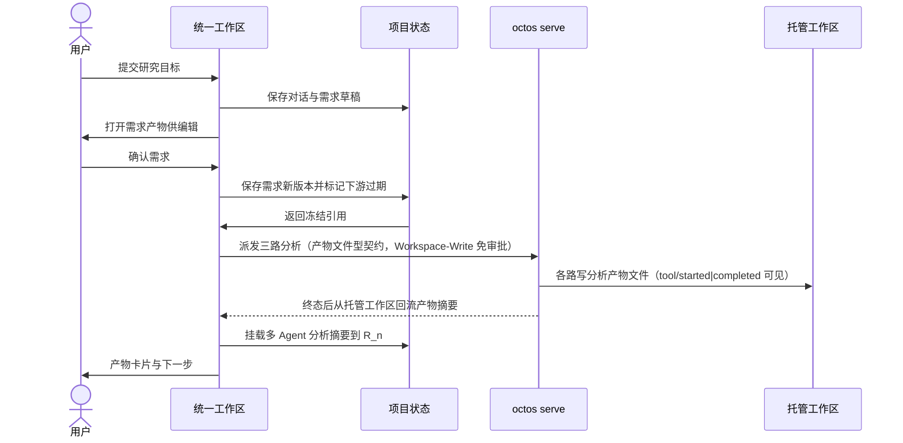

# S17 需求到协作产物

## 需求、对话与项目隔离

输入为空或比例越界不提交。项目切换保存各自对话和草稿；后台任务绑定原项目，取消清除待提交任务。角色和预算不出现在主交互。

生产语义（embed-octos-runtime）：三路契约为产物文件型——每路 sub-agent 在 octos 托管工作区写分析文件，桌面在终态后从工作区回流产物文本挂载需求版本；文件缺失或空白按该路失败处理（诚实口径），聚合校验口径不变。agent 工具执行经 `tool/started`/`tool/completed` 通知在任务条可见。

本地原型动作不构成生产 API。正式接口须由后续运行时时序推导；本次无 API、DB、部署变更。对应检查见 core-S17-test-cases.md。
