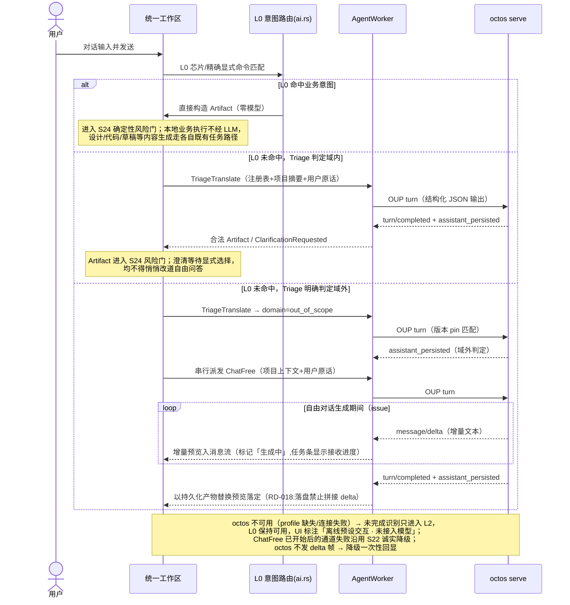
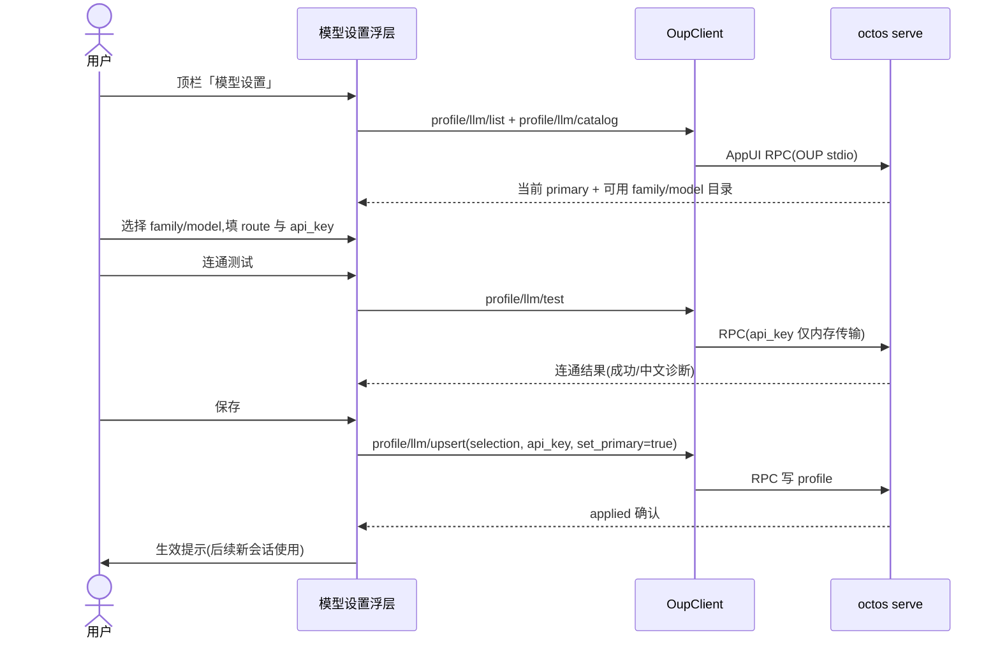

# S22 AI 助手在线对话与模型配置

## 自由对话派发（在线）

自由问答的唯一自然语言入口是 **Triage 的 `domain=out_of_scope` 归约结果**；`Unknown` 不再直接等价于 ChatFree。Triage 中间 JSON 不使用 S22 的聊天流式预览，也不进入消息持久化；ChatFree 的流式、任务条与 `assistant_persisted` 权威口径不变。完整识别/重试/澄清与风险门时序见 `core-S24-intent-as-artifact.md`。

## 模型设置（provider 配置，参考 octoscode 后端）

生产语义（online-chat-llm-config-20261012；fix-issues-40-41-20261013 修订）：

- 自由对话 turn 复用 AgentWorker 单活跃口径：有进行中任务时提示等待或取消，不并发派发。
- **流式回显（issue #41）**：turn 执行期间 `message/delta` 增量帧按 turn_id 归集，实时推入右栏消息流作预览（标记「生成中」）；`turn/completed` 到达后以 `assistant_persisted` 持久化产物替换落定，二者不一致以持久化为准；octos 未发 delta 时降级一次性回显。delta 只进展示预览，不进持久化、不进日志、不进版本化产物。
- api_key 仅经 RPC 内存传输：desktop 不写盘、不进 logs、不入运行记录；浮层不回显已存 key。
- 配置生效于后续新 agent 会话；进行中会话不热切换。
- octos 服务端校验严格（`deny_unknown_fields`，#2166）：客户端只发送契约内字段，未知字段会被 typed error 拒绝，UI 需原样呈现诊断。

本地原型动作不构成生产 API。对应检查见 core-S22-test-cases.md。
