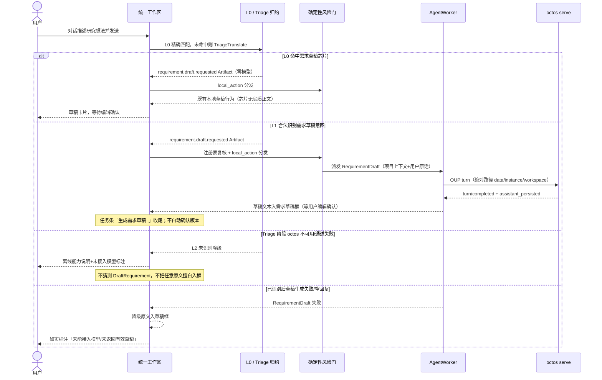

# S23 对话隐式生成需求草稿（issue #39）

## 需求草稿派发（在线）

生产语义（fix-issues-38-39-20261013；intent-as-artifact 修订）：

- 草稿生成复用 AgentWorker 单活跃口径：Triage 与 RequirementDraft 串行派发；有进行中任务时提示等待或取消，不并发派发。
- 只有 L0 或合法 L1 Artifact 才能进入草稿路径；自由问答、ClarificationRequested 和其他意图均不得写入需求草稿框。
- 草稿只填入草稿框（`ai_req_text`），需求版本确认仍由用户在需求页显式执行（草稿不自动生效）。
- 降级按失败阶段区分：Triage 尚未识别时只走 S24 的 L2；已经识别为 DraftRequirement 后，生成失败/空回复才保留原文入草稿框并如实标注，不丢用户输入。
- 草稿内容写入 SQLite 工作区（既有持久化口径），不进 logs 日志文件；Triage 原始 JSON、用户原话与回灌上下文同样不得进入运行记录/logs。

## agent 会话路径口径（issue #38 修复）

- `AgentSessionConfig::desktop_with_profile` 与 `OupClient::spawn` 对数据/实例/工作区目录一律 canonicalize 为绝对路径后再使用：父进程复制 profile 的目标与子进程 `--data-dir` 读取位置必须一致。
- 背景：相对路径 + `Command.current_dir(workspace_root)` 使 `--data-dir` 在子进程内二次解析为嵌套路径，octos 在嵌套空目录初始化 profile store → `session/open` 报 `-32602 profile_unresolved`（详见 issue #38 复现矩阵）。
- 测试口径：新增相对路径回归用例（UT-S17-32），防止测试全用绝对路径掩盖该错位。

本地原型动作不构成生产 API。对应检查见 core-S23-test-cases.md 与 core-S17-test-cases.md。
